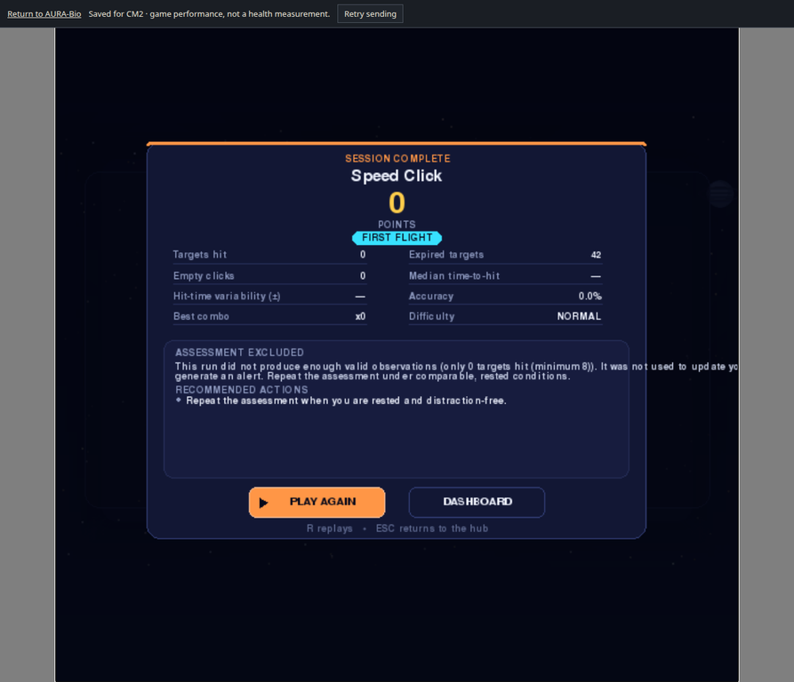

# Offline games and actual Wokwi execution — 2026-11-14

The game hub now cold-launches without public internet while the local AURA-Bio server remains reachable. Actual Wokwi firmware/circuit execution also passed, including a genuine Serial capture delivered unchanged through MQTT into an isolated core. The backend-served calm timeline console, game scoring/timing and model calibration were preserved.

## Cold-offline game launch

Pygbag 0.9.3 / CPython 3.12, its package index and the pygame-ce 2.5.7 WASM wheel are vendored under `web/static/lunar-arcade-hub/runtime/`. Eight runtime files have pinned source URLs, checksums and transformation notes in [SOURCES.json](../web/static/lunar-arcade-hub/runtime/SOURCES.json). `python3 tools/refresh_pygbag_runtime.py` checks the local copies; `--refresh` downloads the pinned sources and fails if upstream bytes change.

The first browser check exposed a public package-index fallback despite local interpreter assets. The final fix configures both `PyConfig` and the bundled `aio.pep0723.Config.PKG_BASE_DEFAULT/PKG_INDEXES` before import scanning. The local index resolves the locally vendored pygame wheel. No gameplay source or bundle content was changed.

Verification used a fresh localhost origin with `Cache-Control: no-store` and enforced same-origin Content Security Policy. All required resources transferred locally, including the interpreter, index, game archive and pygame wheel. An explicit public-CDN fetch was blocked. This tested public-origin independence, not an operating-system-wide network disconnection.

One actual 25-second normal Speed Click round completed through Python → JavaScript → local core. HTTP 200 acknowledged the exact UUID `513595d9-8a41-4c6b-be31-24355fa3bf5f`, crew `cm2`, and mission time `2026-12-23T10:00:00+00:00`. The page displayed “Saved for CM2.” Its UUID appeared once in the seven-row game history, while health stayed at 424 readings and zero rejects. This was a no-hit transport check, not reaction-performance validation or six gameplay trials.

[Structured cold-offline evidence](verification/cold-offline-evidence.json)



## Actual Wokwi firmware and circuit

Only `firmware/` and the hardware requirements document were ported from hardware commit `29b7e82915cf6cb50674cbfcbf70fa2650dedb91`; its older application UI was not imported. Firmware C, custom-chip C, wiring, API header, PlatformIO settings and contract validator match that source exactly. The three committed chip WASM files were refreshed using official Wokwi CLI 0.29.1.

Initial runs authenticated but closed with transport code 1006 before Serial output. A run with freshly compiled chips succeeded. The precise cause of the earlier closure is not established; no firmware/calibration change was made to resolve it. The later control run succeeded with the original 5,970,272-byte fast ELF, so stripping debug information is not required for the demonstrated execution.

The actual default run produced **125 valid readings, zero failures, 35 simulated days and five weekly-lab days**. The seven signals matched their default tolerances, with daily HR/RMSSD/CO₂, weekly labs, UTC timestamps, crew `cm2`, `source: wokwi` and `provenance: simulated`. The capture SHA-256 is `ae2f93757faef73cef510bf20041723096141a6a758e7bddeeae439f2b53504b`.

The existing bridge published all 125 actual captured readings to a separate localhost broker. An isolated core database stored every row exactly, with zero rejects. Replaying the identical capture added zero rows. REST status/timeline and the existing model service worked; model version was `8d30c5cab8db`. This did not overwrite the original user database or mix the capture into the existing 424-reading demo.

A second actual run changed the CO₂ control to **6.5 mmHg**, disabled the pulse sensor for four simulated days, and restored it. It produced **117 valid readings, zero failures, 35 days and five lab days**. Both HR and RMSSD were absent on December 12–15 and recovered on December 16. CO₂ was 6.5 on December 12–18. Timed controls were used because this CLI's `wait-serial` steps joined a diagnostic line to its next JSON record in the capture; those intermediate captures failed validation and were not used as successful evidence. No Serial records were rewritten.

[Genuine default Serial capture](verification/wokwi-defaults-serial.txt) · [Actual bus evidence](verification/wokwi-bus-evidence.json) · [Genuine control capture](verification/wokwi-controls-serial.txt) · [Control evidence](verification/wokwi-controls-evidence.json)

## Reproduce and run

Start the existing core/broker stack before opening `/lunar-arcade-hub/`. The installed server/dependencies and local assets must be available; a cold game launch does not need a CDN cache. This is not a serverless `file://` app or a new service-worker install.

Build the firmware and compile all three chips using [firmware/README.md](../firmware/README.md). For a fast run, set both firmware and ELF paths in `firmware/wokwi.toml` to the fast build. Keep the CI token only in `WOKWI_CLI_TOKEN`.[1] Paired build paths follow the official PlatformIO configuration guidance.[2]

```bash
# Inside firmware/, after building fast and selecting its paired paths:
mkdir -p unneeded
wokwi-cli . --timeout 35000 --timeout-exit-code 0 \
  --serial-log-file unneeded/defaults.txt
wokwi-cli . --scenario tests/controls.yaml --timeout 42000 \
  --timeout-exit-code 0 --serial-log-file unneeded/controls.txt

# From repository root:
uv run python firmware/tools/validate_serial.py --timeline --expect-defaults \
  --crew cm2 firmware/unneeded/defaults.txt
uv run python -m hardware.bridge --file firmware/unneeded/defaults.txt
```

The committed sensor-control scenario uses the official automation format.[3] Wokwi itself is still an online service requiring authentication; the offline claim applies to the games, not the remote simulator. Physical ESP32 capture/flashing/ADC calibration, clinical validity, production auth/TLS, mobile and assistive-technology checks remain outside this verification.

## Final regression and preview

The final source passed **149 pytest tests, one local-artifact skip and one existing Starlette/httpx warning in 82.46 seconds**. Existing Node game-outbox and 90-second PVT deadline checks, source/bundle tests, runtime checksums, firmware-source parity and syntax/whitespace checks passed. The already-verified model image was reused without retraining or rebuilding.

The running core's static directory was updated with a scoped copy; core data and service volumes were preserved. The older core image digest in [integration-verification.md](integration-verification.md) predates these vendored assets. Rebuild core normally when running this source with Docker; this follow-up did not create a new baked core image. The sandbox is a temporary preview, not an always-on publication. Temporary credential files were removed; rotate/revoke the token shared in chat after testing.

## References

[1]: https://docs.wokwi.com/wokwi-ci/cli-usage "Wokwi CLI usage and authentication"
[2]: https://docs.wokwi.com/vscode/platformio "Wokwi PlatformIO firmware and ELF configuration"
[3]: https://docs.wokwi.com/wokwi-ci/automation-scenarios "Wokwi automation scenarios"
